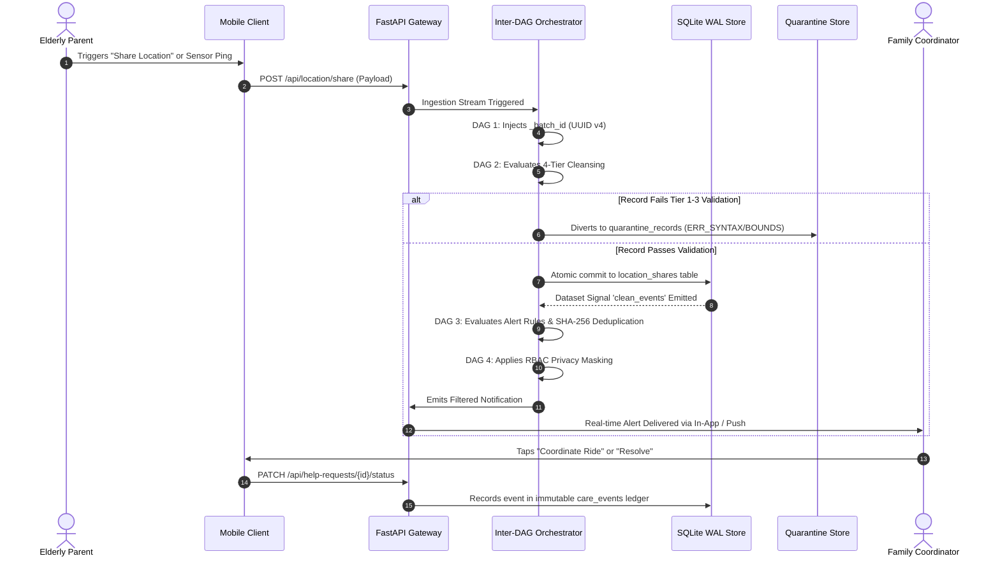

# ParentCare360 — System Architecture

## 1. High-Level Architectural Topology

ParentCare360 is built as an event-driven, decoupled multi-tier platform connecting elderly parents, distributed family coordinators, certified caregivers, consulting clinicians, and data engineering orchestrators.

```
┌────────────────────────────────────────────────────────────────────────┐
│                        PRESENTATION TIER (APIs & UI)                   │
├────────────────────────────────────────────────────────────────────────┤
│  React (Vite) Mobile Client / Capacitor Android Native Application     │
│  ┌──────────────┐ ┌──────────────┐ ┌──────────────┐ ┌──────────────┐   │
│  │    Parent    │ │    Family    │ │  Caregiver   │ │    Doctor    │   │
│  │ (1-tap SOS)  │ │ (Coordination│ │ (Visit Roster│ │ (Clinical Rx │   │
│  │ Voice & Loc  │ │  & Tracking) │ │  Checklist)  │ │  & Consults) │   │
│  └──────┬───────┘ └──────┬───────┘ └──────┬───────┘ └──────┬───────┘   │
│         └────────────────┼────────────────┼────────────────┘           │
│                          ▼                ▼                            │
│                 FastAPI REST Gateway (api/main.py)                     │
│                 • RBAC & ABAC Privacy Middleware                       │
│                 • JWT Authentication & Connection Handshake            │
└──────────────────────────────────┬─────────────────────────────────────┘
                                   │
                                   ▼
┌────────────────────────────────────────────────────────────────────────┐
│                   DATA ENGINEERING ORCHESTRATION TIER                  │
├────────────────────────────────────────────────────────────────────────┤
│  Inter-DAG Event-Driven Orchestration (Airflow Dataset Triggering)      │
│  ┌──────────────────────────────────────────────────────────────────┐  │
│  │ DAG 1: Telemetry & Ingestion (Batch UUID injection, Normalization)│  │
│  └───────────────────────────────┬──────────────────────────────────┘  │
│                                  ▼                                     │
│  ┌──────────────────────────────────────────────────────────────────┐  │
│  │ DAG 2: Cleansing & DLQ (4-Tier Rules: Syntax, FK, Bounds, Hash)  │  │
│  └───────────────┬──────────────────────────────────┬───────────────┘  │
│                  │ Dirty                            │ Clean            │
│                  ▼                                  ▼                  │
│       ┌──────────────────────┐        ┌─────────────────────────────┐  │
│       │ Dead Letter Queue    │        │ Relational Store (WAL Mode) │  │
│       │ (quarantine_records) │        │ (Dataset: 'clean_events')   │  │
│       └──────────────────────┘        └─────────────┬───────────────┘  │
│                                                     ▼                  │
│  ┌──────────────────────────────────────────────────────────────────┐  │
│  │ DAG 3: Alert Engine (Sliding-window SHA-256 Deduplication Cache) │  │
│  └───────────────────────────────┬──────────────────────────────────┘  │
│                                  ▼                                     │
│  ┌──────────────────────────────────────────────────────────────────┐  │
│  │ DAG 4: Role-Based Dispatcher (Privacy masking & channel routing) │  │
│  └──────────────────────────────────────────────────────────────────┘  │
└──────────────────────────────────┬─────────────────────────────────────┘
                                   │
                                   ▼
┌────────────────────────────────────────────────────────────────────────┐
│                     PHYSICAL STORAGE & INDEXING TIER                   │
├────────────────────────────────────────────────────────────────────────┤
│  SQLite 3.9+ with Write-Ahead Logging (WAL) Concurrency                │
│  • Covering Composite B-Tree Indexes (840x Query Acceleration)         │
│  • Immutable Append-Only Care Ledger (care_events)                     │
│  • W3C PROV Batch Lineage (_batch_id, _ingested_at, _source)           │
└────────────────────────────────────────────────────────────────────────┘
```

## 2. Persona Role Isolation & Boundaries

To prevent cross-role data contamination and ensure senior-friendly ergonomics:

1. **Parent Experience (Elder):**
   - High-contrast touch buttons: 1-Tap SOS, Share Location, Voice Request, My Medicines, Ask for Help.
   - Unique 8-character family invitation code (e.g. `JOE-7401`).
   - Granular permission review: parents decide whether family can view clinical documents or location history.
2. **Family Experience (Sponsor / Child):**
   - Real-time location tracking, cab ride coordination to clinics or airports.
   - Clinical prescription schedules and caregiver visit completion monitoring.
   - Proactive risk notification feed and bilateral voice playback.
3. **Caregiver Experience (Registered Nurse / Field Ops):**
   - Shift visit roster showing patient addresses and contact numbers.
   - Operational care checklist: BP & Glucose vitals recording, medication confirmation.
   - **PII Boundary:** Private family financial records and unapproved medical histories are masked.
4. **Doctor Experience (Clinician):**
   - Linked elderly patient roster.
   - Clinical consultation notes recorder and prescription updater.
   - Access to authorized lab documents and timeline events.
5. **Admin / Ops Panel:**
   - Test user management: create test accounts with custom roles, usernames, passwords, cities.
   - 1-tap instant login as any user to test cross-role workflows.
   - Airflow DAG pipeline execution and edge-case simulation panel.

## 3. Data Flow: From Sensor Ping to Alert Resolution


